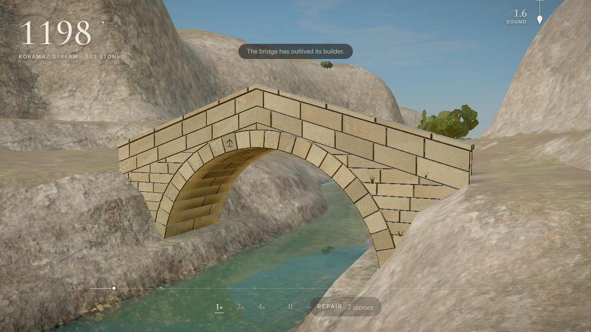

# Kemer: Seni Aşan Köprüler

*Taşları diz, iskeleyi sök. Dokuz yüz yıl dayanacak mı?*

Kemer, gerçek Anadolu nehirlerinde taş kemer köprü kurduğun bir tarayıcı oyunu. Kemerin eğrisini çizer, kalınlığına karar verir, taşları ahşap iskeleye dizer, kilit taşını yerine indirir ve iskeleyi sökersin. Sonra zamanı akıtırsın: seller, depremler, don ve yük köprünü 2026'ya kadar sınar.



**Oyna:** https://sonergunes741.github.io/kemer/

## Ne var

- **On iki nehir, on iki kuşak.** 1147'de Ağırnas'taki Koramaz Deresi'nden 1427'de 174 kemerli Uzunköprü'ye; Kızılırmak, Yeşilırmak, Dicle, Batman Çayı, Aras, Arpaçay, Fırtına, Sakarya ve Tunca üzerinden. Her nehir tek bir yeni fikir öğretir.
- **Şans yok.** Köprünün kaderini gerçek taş yapı mühendisliği belirler: itki hattı taşın içinde kalırsa kemer durur. Aynı köprü her seferinde aynı sonucu verir; yıkılırsa nedenini görürsün.
- **Üç mühür.** 2026'da ayakta ol, ustanın taş sayısını aşma, en büyük seli onarımsız atlat.
- **Aile işareti.** Seçtiğin taşçı işareti her köprünün bir taşına kazınır. Son bölümde ailenin son ferdi, senin yüzyıllar önce kurduğun köprüde o işareti bulur.
- **Günün Nehri** ve **Bin Yıl Meydan Okuması.** Zaman atlamalı videonu paylaş: "Benimki 879 yıl dayandı. Seninki?"
- Türkçe ve İngilizce; fare, klavye ve dokunmatik; çevrimdışı çalışır.

## Mühendislik

Karar, taş kemerlerin limit analizinden gelir (Heyman): çekme taşımayan rijit taşlar, eklemlerde sürtünme ve ezilme. Her soru küçük bir doğrusal programdır. Testler literatürdeki değerleri tutturur (yarım daire kemerin en küçük kalınlığı 0,1075 R, Milankovitch 1907; yatay ivme ve mesnet açılması için Ochsendorf 2002) ve sonuçlar, kod paylaşmayan ikinci bir kinematik yöntemle karşılaştırılır. Sel için Manning ve Gumbel, ayak oyulması için HEC-18 kullanılır. Ayrıntı: [docs/SIM-SPEC.md](docs/SIM-SPEC.md). Tarihî bilgiler ve kaynakları: [docs/research/notes.md](docs/research/notes.md).

## Geliştirme

Node 20.19 veya üstü gerekir.

```bash
npm ci
npm run dev        # http://127.0.0.1:5173
npm test           # birim testleri
npm run typecheck
npm run build      # dist/
npm run balance    # bölüm dengesi tablosu
```

Yapı: `src/sim` (mühendislik, saf TypeScript), `src/render/world` (arazi, su, gökyüzü), `src/render/bridge` (taşlar, iskele, yıkılış, trafik), `src/audio` (tamamı sentez), `src/ui`, `src/content` (nehirler ve hikâye), `src/game` (akış). Tasarım ve mimari: [docs/DESIGN.md](docs/DESIGN.md), [docs/ARCHITECTURE.md](docs/ARCHITECTURE.md), denge: [docs/BALANCE.md](docs/BALANCE.md).

## Teşekkür

Taş, zemin ve ahşap dokuları ile kaya taramaları [Poly Haven](https://polyhaven.com)'dan (CC0); ağaçlar, insanlar, hayvanlar ve araçlar Blender'da bu oyun için yapıldı ([public/assets/CREDITS.md](public/assets/CREDITS.md)). three.js, postprocessing, Rapier; Inter ve Cormorant Garamond yazı tipleri.

## Lisans

Tüm hakları saklıdır: [LICENSE](LICENSE).

---

**English.** Kemer is a browser game about building stone arch bridges on real Anatolian rivers. Draw the arch, lay the stones on timber centering, set the keystone, strike the centering, then let time run from the build year to 2026 while floods, earthquakes and weather test the work. Its verdicts come from real masonry limit analysis, so the same bridge always meets the same fate. Twelve rivers, twelve generations of one stonemason family, an epilogue on your own surviving bridge, a river of the day and a thousand-year challenge. Turkish and English. All rights reserved.
